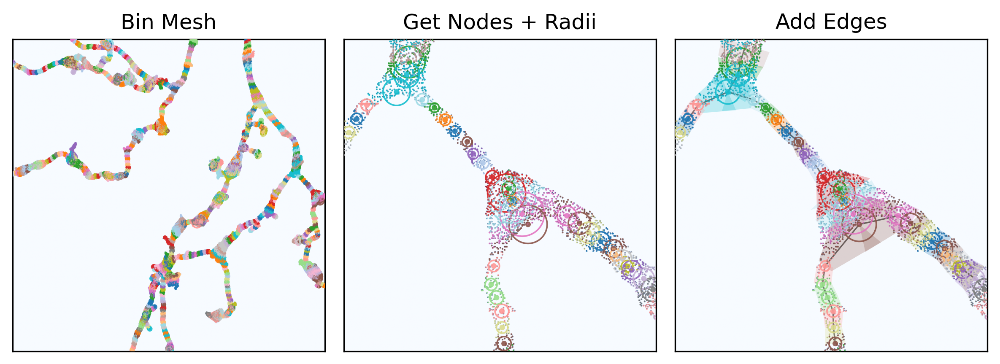
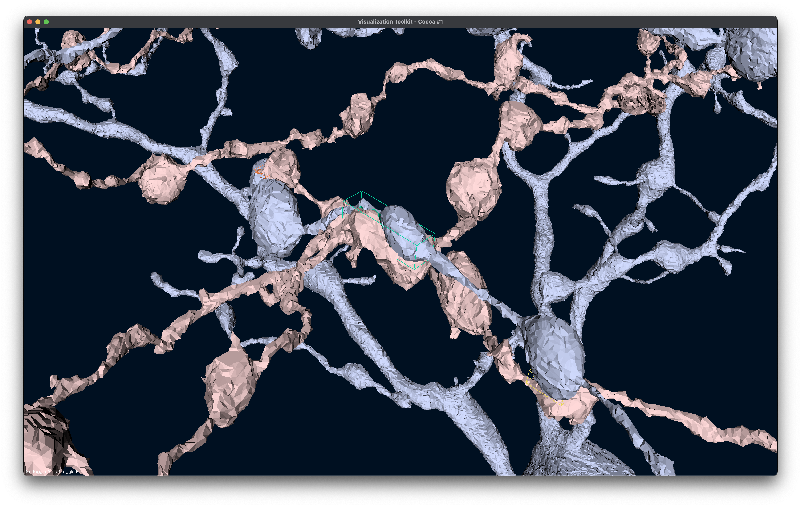
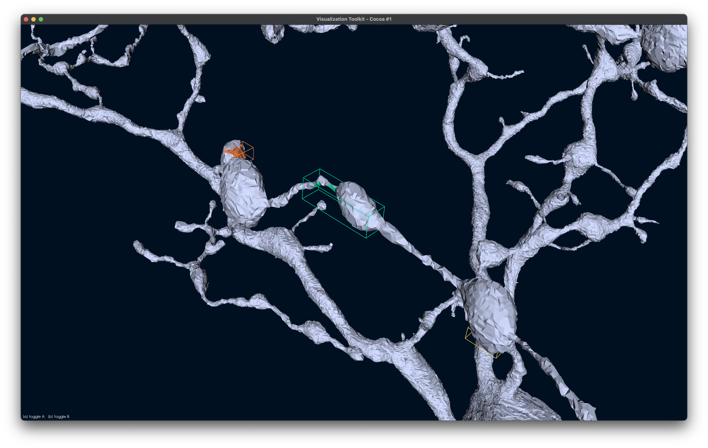
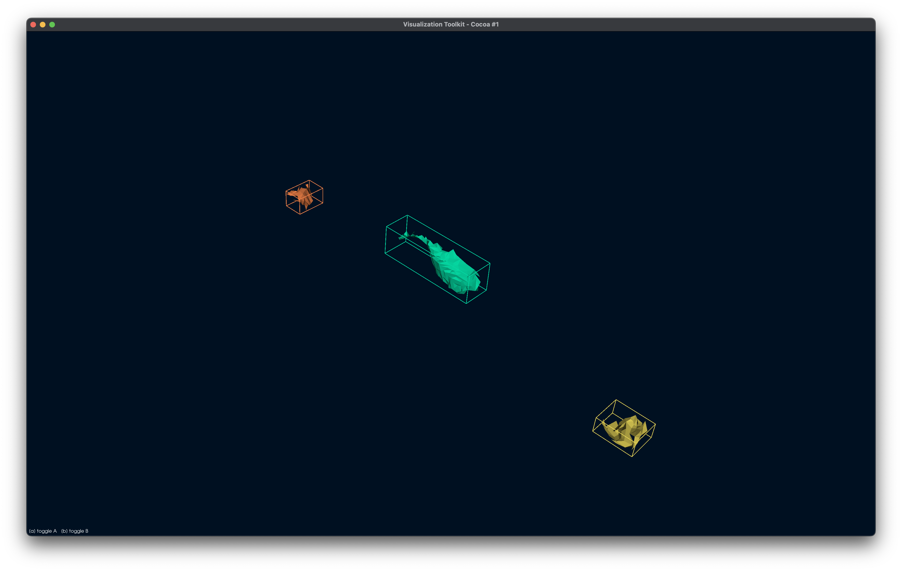

# skeliner

[](https://badge.fury.io/py/skeliner)

A lightweight skeletonizer that converts neuron meshes into biophysical‑modelling‑ready morphologies. 



## Features

- Mesh Preprocessing
    - remove mesh anomolies such as parallel faces due to chunk merging failures, gaps (broken neurites), fusions (wrong connections)
    - find and classify soma, organelles, neurites and fragments that should be descarded 

- Mesh → SWC skeletons
    - Center‑line, acyclic skeleton.
    - Per‑node radii with multiple estimators (median/mean/trim) and an automatic recommendation.
    - Ellipsoidal soma detection near the soma centroid.
    - Bridges disconnected mesh components back to the soma (gap‑closing) and prunes tiny peri‑soma artefacts.
    - SWC and NPZ export with metadata;

- Pairwise contact sites (two cells)
    - Skeleton‑based seeding: fast KD‑tree search finds node↔node proximity pairs with tolerance; returns contact
      midpoints and per‑node loci.
    - Mesh‑based patches: around seeds, projects to both meshes and extracts touching triangle patches; returns per‑site
      areas on A/B and their mean, plus compact AABBs for downstream use.
    - Optional skeleton‑only approximation of contact sites/areas when meshes are unavailable.

- I/O, visualization, diagnostics and post-processing
    - Read/write SWC and compact NPZ; load meshes via `trimesh`.
    - 2D projections and 3D viewers for meshes, skeletons, and contact patches.
    - Various diagnostics and post-processing tools.

## Installation

```bash
pip install skeliner
```

or from source, which builds the Rust core and so needs a Rust toolchain
([rustup](https://rustup.rs)):

```bash
git clone https://github.com/berenslab/skeliner.git

# with uv
uv sync --all-extras

# or not
pip install -e "skeliner[dev]"
```

## Quickstart

### Mesh preprocessing and skeletonization

Since v0.4.0, the recommended pipeline is the preprocess route. The mesh preprocessing will clean up most artifacts that would potentially degrade the quality of the skeletons, which includes identifying internal organelles surfaces, locating the soma, and also bridging disconnected paths. All these are done in one call automatically. The skeleton then can be estimated from the cleaned mesh and the identified components (organelles, soma, and neurites):

```python
import skeliner as sk

mesh = sk.io.load_mesh("cellA.obj") 
mesh, components = sk.preprocess(mesh, compact=True, verbose=True)
skel = sk.skeletonize(mesh, components, unit="nm", verbose=True)

# Save SWC (e.g. convert nm → µm on write)
skel.to_swc("cellA.swc", scale=1e-3)
# Also persist a compact NPZ for fast reload
skel.to_npz("cellA.npz")
```

### Find contact sites between two cells (skeleton + mesh)

```python
import skeliner as sk

meshA = sk.io.load_mesh("cellA.obj")
meshB = sk.io.load_mesh("cellB.obj")

sites = sk.pair.scan_contact(meshA, meshB, unit="nm^2")
print("contact patches:", len(sites.faces_A))
print("mean areas (mesh units^2):", sites.area_mean)

# Optional: visualize patches
# sk.plot.view_contacts(meshA, meshB, sites, sides="A")
```

<p align="center">
  
  
  
</p>

### Threads

The Rust core runs its heaviest loops on every core by default. To use fewer
(a shared machine, or several cells at once on one node), set
`RAYON_NUM_THREADS` before Python starts, or in a notebook's first cell
(`%env RAYON_NUM_THREADS=4`), or switch at any time from Python:

```python
sk.threads(4)          # from now on
with sk.threads(2):    # for this block only
    mesh, components = sk.preprocess(mesh)
sk.threads(None)       # back to the default: every core, or RAYON_NUM_THREADS
sk.threads.get()       # how many threads the next parallel loop runs on
```

---

See [example notebooks](https://github.com/berenslab/skeliner/tree/main/notebooks) for more usage. 
